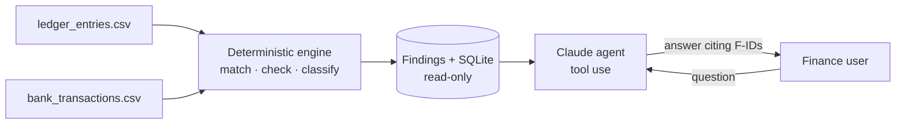

# LedgerLens

**Reconcile a payments ledger against the bank feed, then ask an AI analyst what went wrong.**

Month-end reconciliation means checking every payment your books say you received against what
actually landed in the bank. When the two disagree, someone has to work out why: a duplicated
deposit, a processor fee keyed in wrong, a split payment that doesn't add up, or a customer who
paid under a different name. LedgerLens does that matching automatically and lets a finance user
ask questions in plain English, such as *"Why is PMT-1038 short?"* or *"What should I fix first?"*

```text
$ python -m ledgerlens reconcile data/sample
Matched 253 of 262 ledger entries to the bank feed (20 matched without a reference, 6 still in transit).
19 findings flag $5,644.38: 9 high, 8 medium, 2 low.

F-001  [high  ] DUPLICATE_PAYMENT     PMT-1179 was deposited twice: T-90174 and T-90257 ($956.58 each).
F-002  [high  ] UNMATCHED_BANK        Bank deposit T-90259 from INITECH REMIT ($889.69) matches no ledger entry.
...
F-013  [medium] FEE_MISCALC           PMT-1118 records an ACH fee of $7.25; the schedule gives $5.00 on $708.16.
```

## Design principle: the model explains, the code decides

Money is the wrong place for a language model to do arithmetic. So the work is split in two:



1. **Deterministic engine** (`reconcile.py`): matches every deposit to a ledger entry, checks fees
   against the processor's schedule, and classifies each problem with its evidence. All money math
   uses `Decimal`, never floats.
2. **AI analyst** (`agent.py`): Claude gets three tools: `list_findings`, `get_finding`, and
   `run_sql`. It must cite finding IDs and may only quote numbers that a tool returned, so every
   answer can be checked. The UI shows each lookup the agent made.

## What it catches

| Finding | Example |
|---|---|
| `DUPLICATE_PAYMENT` | The same payment reference was deposited twice |
| `UNMATCHED_BANK` | Money arrived that no ledger entry explains |
| `UNMATCHED_LEDGER` | The ledger expects money that never arrived (outside the in-transit window) |
| `AMOUNT_MISMATCH` | The deposit differs from the expected net, after fee errors are accounted for |
| `FEE_MISCALC` | The recorded processor fee doesn't match the fee schedule |
| `SPLIT_TOTAL_MISMATCH` | An invoice paid in parts whose parts don't sum to the invoice |
| `PAYEE_MISMATCH` | The deposit came from a different company than the one booked |

Two details that matter in real data:

- **Root cause, not symptoms.** A wrong fee also makes the expected net wrong, which would look
  like a short deposit too. The engine attributes the difference to the fee error and reports
  `AMOUNT_MISMATCH` only for the part the fee doesn't explain.
- **Messy bank feeds.** Banks upper-case, strip and truncate names (`CEDAR RIDGE PROPER`) and
  sometimes drop the payment reference. When there's no reference, LedgerLens falls back to
  matching on exact amount, a ±3-day window and fuzzy payer name, and only accepts a match when
  exactly one candidate fits.

## Evaluation

`scripts/generate_sample_data.py` builds a realistic two-month dataset (262 ledger rows, 258 bank
rows, 10 split invoices, 20 deposits with missing references) and injects 19 known problems,
recorded in `injected_issues.json`. `ledgerlens.evaluate` scores the engine against them:

```text
$ python -m ledgerlens.evaluate data/sample
precision 100%  recall 100%
```

The test suite repeats this across five random seeds. This harness also caught a real bug during
development: a float rounding error in the generator made one split invoice a cent off.

## Safety

The agent writes its own SQL, so the SQLite connection installs an **authorizer callback** that
denies every operation except reads. Writes, schema changes and `ATTACH` are refused by the
database engine itself, not by pattern-matching the query text. Tests cover each case.

## Run it

```bash
python -m venv .venv && source .venv/bin/activate
pip install -r requirements-dev.txt

python -m ledgerlens reconcile data/sample          # findings in the terminal
python -m ledgerlens.evaluate data/sample           # score against injected issues
pytest -q                                           # 24 tests

export ANTHROPIC_API_KEY=sk-ant-...                  # optional: enables the AI analyst
python -m ledgerlens ask data/sample "What should I fix first?"
streamlit run app.py                                # web app
```

Without an API key everything still works except the chat, which falls back to a deterministic
briefing. Set `LEDGERLENS_MODEL` to choose a different Claude model.

## Input format

`ledger_entries.csv`: `entry_id, date, payer, invoice_id, method (ACH|CARD|WIRE), amount, fee, net, split_group, invoice_total`

`bank_transactions.csv`: `txn_id, date, counterparty, memo, amount`

Fee schedule (`fees.py`): ACH 0.8% capped at $5.00 · Card 2.9% + $0.30 · Wire $15.00 flat.

## Project layout

```
ledgerlens/
  fees.py        fee schedule in Decimal
  data.py        CSV loading and validation with row-level error messages
  reconcile.py   matching engine and finding classification
  store.py       read-only SQLite for the agent
  agent.py       Claude tool-use loop and offline briefing
  evaluate.py    precision/recall against injected issues
scripts/generate_sample_data.py
app.py           Streamlit UI
tests/           24 tests, including a scripted fake client for the agent loop
```

## Next steps

- Learn payer aliases from confirmed matches (e.g. "NSTAR HVAC" → Northstar HVAC Services)
- Export proposed journal corrections as a CSV for the accounting system
- Run on a schedule and post high-severity findings to Slack

---
Built by [Sandra Sumesh](https://github.com/sandrasumesh). The idea came from my work on payment and fee workflows in a production business application.
